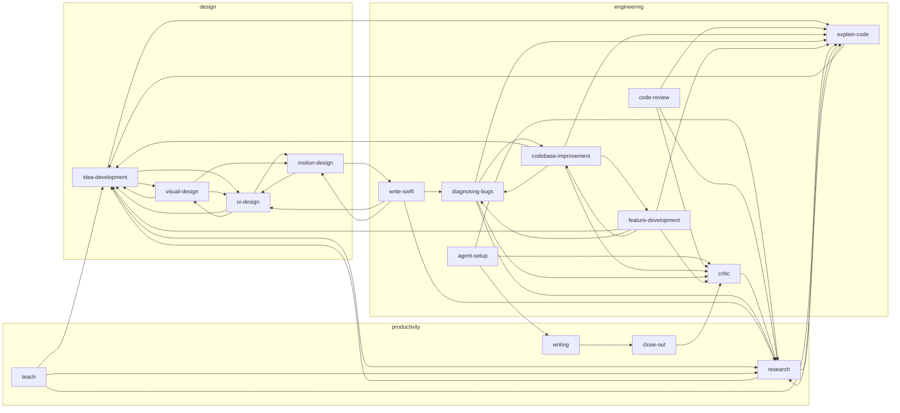

# How the skills fit together

Each skill has a page in this folder: what it does, when to reach for it, what
"working" looks like, and where it hands off.

| Bucket | Skills |
| --- | --- |
| Engineering | [feature-development](engineering/feature-development.md), [diagnosing-bugs](engineering/diagnosing-bugs.md), [codebase-improvement](engineering/codebase-improvement.md), [explain-code](engineering/explain-code.md), [code-review](engineering/code-review.md), [critic](engineering/critic.md), [agent-setup](engineering/agent-setup.md), [write-swift](engineering/write-swift.md) |
| Design | [idea-development](design/idea-development.md), [ui-design](design/ui-design.md), [visual-design](design/visual-design.md), [motion-design](design/motion-design.md) |
| Productivity | [research](productivity/research.md), [writing](productivity/writing.md), [teach](productivity/teach.md), [close-out](productivity/close-out.md), [next](productivity/next.md) |

## The collaboration pattern

Collections of small skills make you ask "which skill is next?". These are named
after the work you already know you're starting, not after the techniques inside
it. Questioning, research, prototypes, and decision notes are tools each skill
reaches for when they help, not steps you have to sequence.

The decision and design skills share a collaboration pattern:

- **Look before asking.** The agent reads what it can find before spending your
  attention.
- **Something concrete to disagree with.** Usage examples, before/after
  structure, working prototypes, not abstract questions.
- **Real options, honest costs.** Genuinely different alternatives, each with
  when it wins and what it costs. You choose.
- **A handoff, not a transcript.** Decisions and plans someone else can build
  from without replaying the conversation.

Debugging, reviewing and checking completion each have their own outcome.
Motion and Swift add specialist knowledge when the work needs it.

## How skills trigger each other

Every skill ends with a `## Handoffs` block: a short list of *when* this
happens, *then* that skill. Each entry is one of two kinds.

- **run**: the work now belongs to that skill. The agent carries the context
  across and continues, unless your request stops short of it, in which case the
  skill is only suggested. A bug found while building a feature runs
  diagnosing-bugs; a built feature runs critic.
- **suggest**: a separate job that is your call. The agent names it in one
  closing line once its own deliverable is final, and never continues unasked.
  A finished review suggests close-out; a settled plan suggests building it. Planning, design, explaining and verifying skills never start edits on their own, and the check enforces that.

A skill you haven't installed never blocks anything; the work happens inline.
**next** holds the whole map for the moment you don't know where you are. The
blocks in the `SKILL.md` files are the source of truth: `npm run check` rejects
a handoff to a skill that doesn't exist, a skill nothing hands off to, a
`next` that forgets one, and any generated section on this page or on a skill
page that no longer matches them. `node scripts/graph.ts --write` regenerates
those sections.

## Lanes

Common routes through the set. Each hop is a real handoff, which the check
verifies; none is a required sequence.

- **Build a feature**: idea-development → feature-development → critic → close-out
- **Fix a bug**: diagnosing-bugs → critic → close-out
- **Reshape code**: codebase-improvement → feature-development → critic → close-out
- **Design a screen**: idea-development → ui-design → visual-design → motion-design → feature-development → critic
- **Understand a codebase**: explain-code → teach
- **Decide on evidence**: research → idea-development → feature-development
- **Review and ship**: code-review → critic → close-out
- **Make a repo agent-ready**: agent-setup → critic → close-out

## The map

Solid arrows are `run` handoffs: the work moves on by itself. The table lists
every handoff, including the `suggest` ones. **next** suggests any skill and is
left off the graph.

<!-- handoffs:start -->

| Skill | Runs | Suggests |
| --- | --- | --- |
| [idea-development](design/idea-development.md) | research, visual-design, ui-design, explain-code | codebase-improvement, feature-development, teach |
| [motion-design](design/motion-design.md) | ui-design, write-swift | feature-development, visual-design, diagnosing-bugs, code-review |
| [ui-design](design/ui-design.md) | idea-development, visual-design, motion-design | feature-development, write-swift |
| [visual-design](design/visual-design.md) | idea-development, ui-design, motion-design | feature-development, write-swift |
| [agent-setup](engineering/agent-setup.md) | writing, research, critic | feature-development, close-out |
| [code-review](engineering/code-review.md) | critic, explain-code, research | diagnosing-bugs, codebase-improvement, idea-development, feature-development, close-out |
| [codebase-improvement](engineering/codebase-improvement.md) | idea-development, diagnosing-bugs, explain-code, feature-development, critic | agent-setup, close-out |
| [critic](engineering/critic.md) | research | code-review, diagnosing-bugs, feature-development, close-out |
| [diagnosing-bugs](engineering/diagnosing-bugs.md) | codebase-improvement, research, explain-code, critic | close-out |
| [explain-code](engineering/explain-code.md) | research, idea-development | diagnosing-bugs, feature-development, codebase-improvement, teach, writing |
| [feature-development](engineering/feature-development.md) | idea-development, diagnosing-bugs, codebase-improvement, explain-code, critic | code-review, close-out, agent-setup |
| [write-swift](engineering/write-swift.md) | ui-design, motion-design, diagnosing-bugs, research | feature-development, code-review |
| [close-out](productivity/close-out.md) | critic | code-review, writing, agent-setup |
| [research](productivity/research.md) | idea-development, explain-code | diagnosing-bugs, feature-development, teach |
| [teach](productivity/teach.md) | idea-development, research, explain-code | feature-development |
| [writing](productivity/writing.md) | close-out | explain-code, research, agent-setup, teach |
<!-- handoffs:end -->
